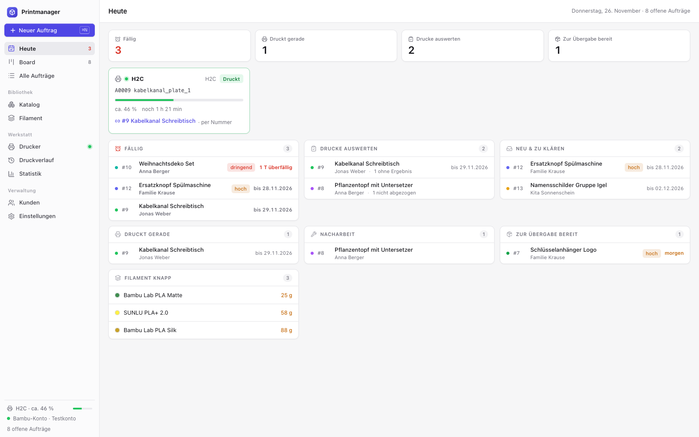
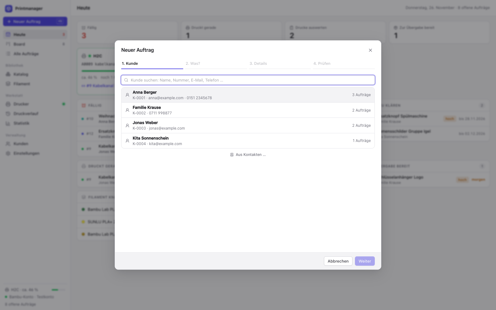
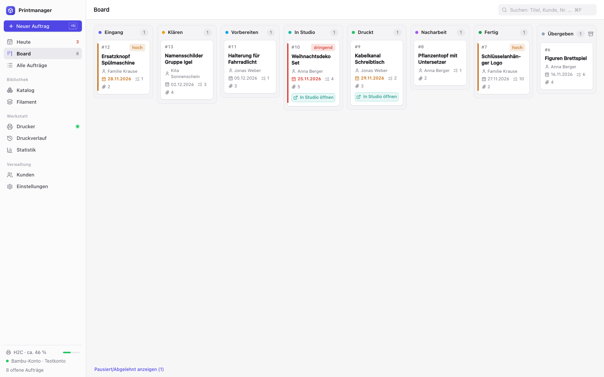
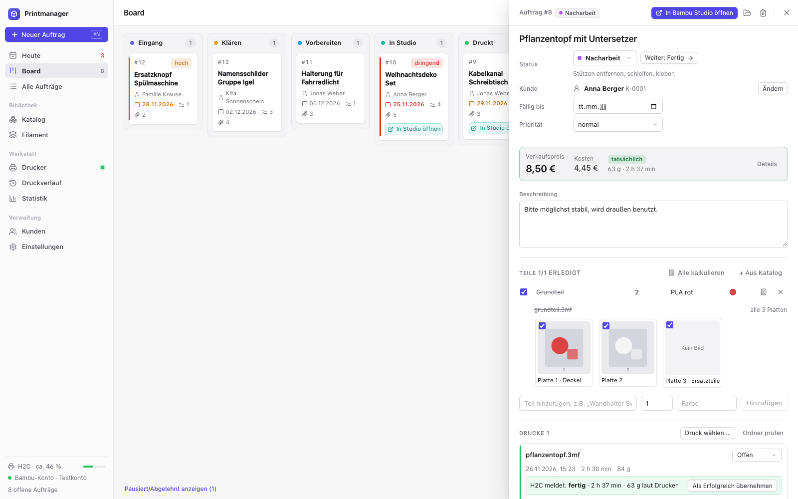
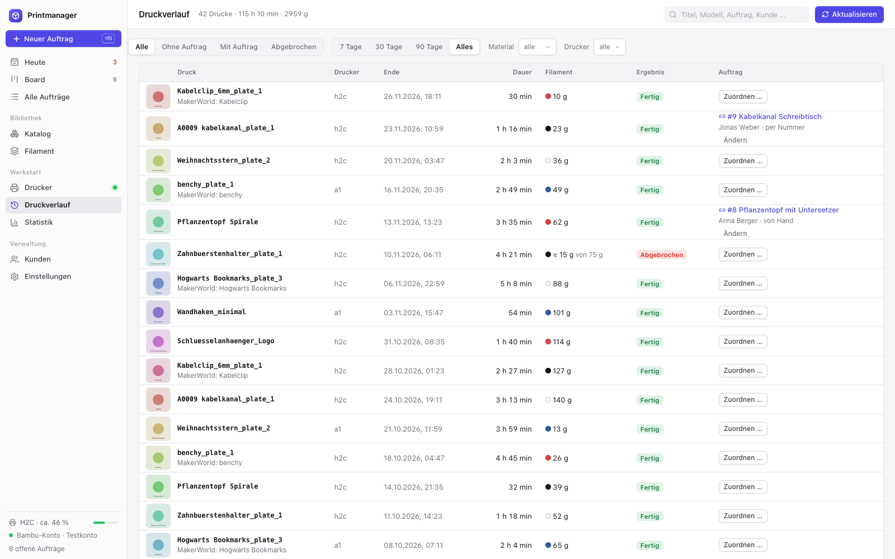
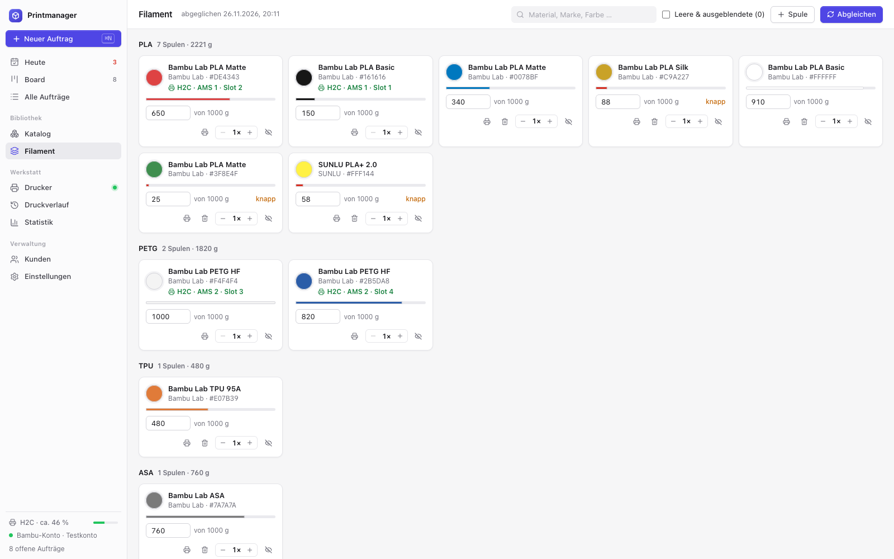
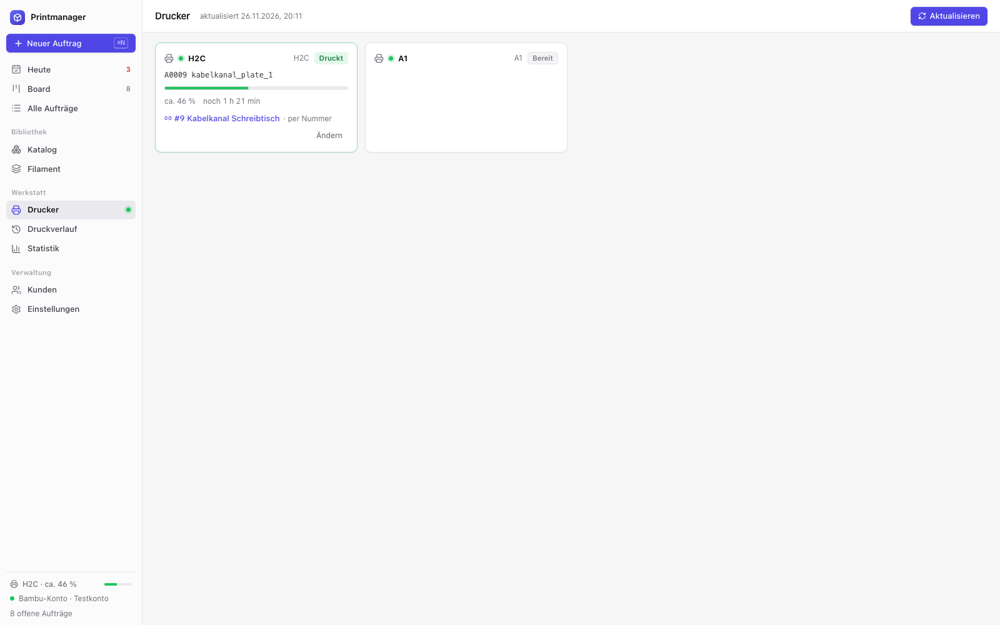
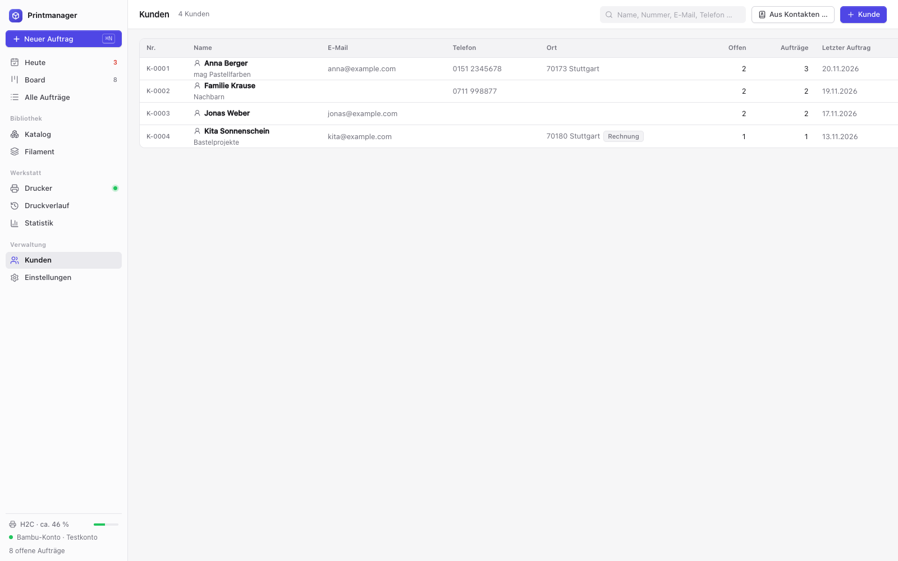

<div align="center">

# Printmanager

Wer mit einem Bambu-Lab-Drucker für Familie, Freunde oder einen kleinen Kundenkreis druckt, behält hier Aufträge, Filament und Kosten im Blick.

[**Download für macOS und Windows**](https://github.com/aidun/printmanager/releases/latest) · [Benutzerhandbuch](docs/BENUTZERHANDBUCH.md) · [Änderungen](CHANGELOG.md) · [Für Entwickler](#für-entwickler)



</div>

---

## Was die App macht

Ein Druckwunsch wird zum Auftrag: Kunde, Teile, Farbwünsche, Dateien, Bilder und Notizen an einer Stelle. Der Auftrag läuft durch feste Schritte von „Eingang“ bis „Übergeben“.

- **Bambu Studio:** Ein Klick öffnet die Datei. Speicherst du sie gesliced im Auftragsordner, übernimmt die App Druckzeit und Gramm.
- **Drucker:** Status, geschätzter Fortschritt und Restzeit laufender Drucke. Fertige Drucke landen mit ihrer echten Dauer im passenden Auftrag.
- **Filament:** Die Spulen kommen aus deinem Bambu-Konto, mit AMS-Slot. Nach dem Druck schlägt die App die Spule vor, von der der Verbrauch abgeht.
- **Kosten und Preis:** vor dem Druck geschätzt, danach tatsächlich. Filament- und Strompreis, Maschinenkosten und Aufschlag stellst du selbst ein.
- **Statistik:** Verbrauch, Druckzeit und Fehldrucke. Bei abgebrochenen Drucken zählt der geschätzte Verbrauch bis zum Abbruch, nicht der geplante.

---

## So arbeitest du damit

### 1 · Auftrag anlegen
Du suchst den Kunden oder legst ihn neu an. Dann wählst du ein Projekt aus dem Katalog, fügst einen Link von MakerWorld oder Printables ein oder ziehst eigene Dateien hinein. Schon hier zeigt die App geschätzte Kosten und einen Preisvorschlag.



### 2 · Den Überblick behalten
Das Board zeigt jeden Auftrag in seinem Arbeitsschritt. Zum Weiterschalten ziehst du die Karte in die nächste Spalte. Auf der Seite **Heute** stehen Fälliges, laufende Drucke und Drucke, die noch ausgewertet werden müssen.



### 3 · Drucken, erfassen, abrechnen
Im Auftrag öffnest du die Druckdatei in Bambu Studio. Nach dem Druck kommen Dauer und Gramm aus deinem Bambu-Konto. Du ziehst das Filament von der Spule ab, und die Kalkulation zeigt statt der Schätzung die **tatsächlichen Kosten**.



---

## Die Seiten

### Druckverlauf
Hier stehen alle Drucke aus deinem Bambu-Konto, mit Vorschaubild, echter Dauer und Filament.
- Filtern kannst du nach Zeitraum, Material, Drucker und Ergebnis.
- Über eine Suche ordnest du einen Druck nachträglich einem Auftrag zu.
- Bei Abbrüchen schätzt die App, wie viel bis zum Abbruch verbraucht wurde, etwa „≈ 15 g von 84 g“.



### Statistik
Filament, Druckzeit, Fehldrucke und Übergaben, aufgeteilt nach Monat, Kunde und Material.
- Ausgewertet werden wahlweise **alle Drucke im Konto** oder **nur Aufträge**.
- Gefiltert wird nach fertigen, erfolgreichen, abgebrochenen oder geplanten Drucken.


### Katalog und MakerWorld
Projekte, die du öfter druckst, stehen hier mit Vorschau, Druckzeit und Filamenten. Deine **MakerWorld-Sammlungen** erscheinen von selbst. Die 3MF-Datei lädt die App erst, wenn du sie brauchst.


### Filament
Alle Spulen mit Restmenge, nach Material gruppiert. Knappe Spulen sind markiert, und jede Spule zeigt den Slot, in dem sie gerade steckt. Auf Wunsch schreibt die App den neuen Rest ins Bambu-Konto zurück, und mit − und + änderst du dort den Vorrat gleicher Spulen.



### Drucker und Kunden
Die Drucker-Seite zeigt Status, Fortschritt und den zugehörigen Auftrag. In der Kundenverwaltung hat jeder Kunde eine Kundennummer, eine Adresse, optional eine abweichende Rechnungsadresse und eine Liste seiner Aufträge.

| Drucker | Kunden |
|---|---|
|  |  |

---

## Daten und Konto

- **Speicherort:** Alles liegt in einer Datenbank auf deinem Rechner. Zum Sichern kopierst du den Datenordner.
- **Drucker:** Printmanager steuert keinen Drucker. Drucke startest du in Bambu Studio oder Bambu Handy.
- **Bambu-Konto:** Ab Werk liest die App nur. Schaltest du das Schreiben ein, schreibt sie den Rest deiner Spulen und den Spulenvorrat zurück, jedes Mal erst nach deiner Bestätigung.
- **Anmeldung:** Du meldest dich im Fenster von Bambu Lab an, dein Passwort sieht die App nicht. Das Anmelde-Token liegt im Schlüsselbund deines Systems.

> Hinweis: Die Anbindung an das Bambu-Konto nutzt Schnittstellen, die Bambu nicht offiziell dokumentiert. Ändert Bambu sie, arbeitet die App mit den zuletzt bekannten Daten weiter.

---

## Installation

1. Lade die neueste Version unter [**Releases**](https://github.com/aidun/printmanager/releases/latest):
   - **macOS** (Apple Silicon und Intel): `Printmanager_…_universal.dmg`
   - **Windows**: `Printmanager_…_x64-setup.exe`
2. Installiere und starte die App. Die Builds sind noch nicht signiert:
   - macOS: Beim ersten Start Rechtsklick → **Öffnen**.
   - Windows: Bei SmartScreen **Weitere Informationen → Trotzdem ausführen**.
3. Optional: Unter **Einstellungen → Anbindungen → Bambu-Konto → Anmelden** verbindest du dein Konto. Dann kommen Filament, Drucker, Druckverlauf und MakerWorld dazu.

**Voraussetzungen:** macOS 11 oder neuer bzw. Windows 10 oder 11, dazu Bambu Studio zum Slicen. Ein Bambu-Lab-Konto ist optional.

---

## Häufige Fragen

**Brauche ich ein Bambu-Konto?** Nein. Aufträge, Katalog, Kalkulation und der Weg zu Bambu Studio funktionieren auch ohne. Mit Konto kommen Filament, Druckerstatus, Druckverlauf und MakerWorld dazu.

**Wie genau ist der Verbrauch?** Der Drucker misst den Verbrauch nicht. Die Gramm stammen aus dem Slicer. Bei abgebrochenen Drucken schätzt die App den tatsächlichen Anteil aus dem Fortschritt oder der Laufzeit.

**Wie entsteht der Preisvorschlag?** Die App rechnet (Material + Strom + Maschine) × (1 + Puffer für Fehldrucke) × Preisfaktor + Pauschale, rundet auf und geht nie unter den Mindestpreis. Alle Werte stellst du unter **Einstellungen → Kalkulation** ein.

**Ändert die App mein Bambu-Konto?** Ab Werk nicht. Schaltest du unter **Einstellungen → Anbindungen** das Schreiben ein, kann sie den Rest deiner Spulen zurückschreiben und Spulen anlegen oder löschen, jedes Mal erst nach deiner Bestätigung. Drucker steuert sie nie.

**Funktioniert es mit mehreren Druckern?** Ja. Alle Drucker deines Bambu-Kontos stehen auf der Drucker-Seite.

Mehr steht im [Benutzerhandbuch](docs/BENUTZERHANDBUCH.md).

---

## Für Entwickler

Tauri 2 (Rust) mit React/TypeScript, dazu SQLite (optional PostgreSQL).

```bash
npm install
```

```bash
npm run app:dev
```

Startet die Entwicklerversion „Printmanager Dev“ mit eigenem Datenordner. Sie kommt der installierten App nicht in die Quere.

```bash
npm run dev
```

Startet nur die Oberfläche unter http://localhost:1420, mit Beispieldaten aus `src/devmock.ts`. Einzelne Ansichten öffnest du über die Adresse, z.B. `#board&order=o8` oder `#today&neu`. So entstehen auch die Produktbilder in `docs/images/`.

```bash
cd src-tauri && cargo test
```

- Regeln, Befehle und Konventionen: [AGENTS.md](AGENTS.md)
- Aufbau, Datenmodell und Schnittstellen: [docs/ARCHITEKTUR.md](docs/ARCHITEKTUR.md)
- CI läuft bei jedem Push. Release-Builds für macOS und Windows entstehen über Tags `vX.Y.Z` (`.github/workflows/`).
- Entscheidungen und frühere Pläne: [docs/history/](docs/history/)

**Daten:** `~/Library/Application Support/de.printmanager.app` (Windows: `%APPDATA%\de.printmanager.app`) mit `printmanager.db`, `orders/<Nr>/`, `catalog/<id>/` und `trash/`.
