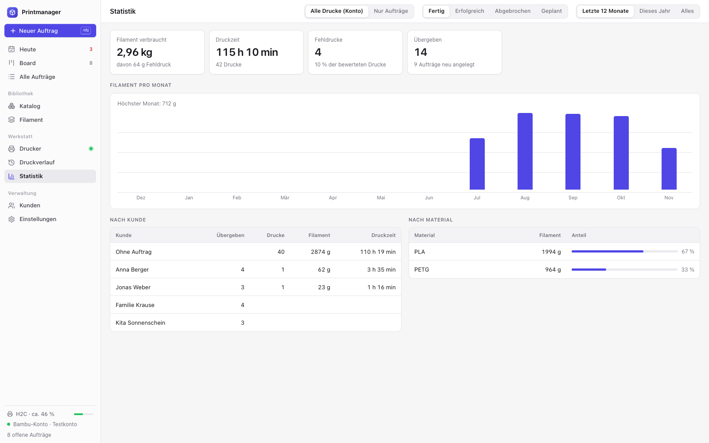
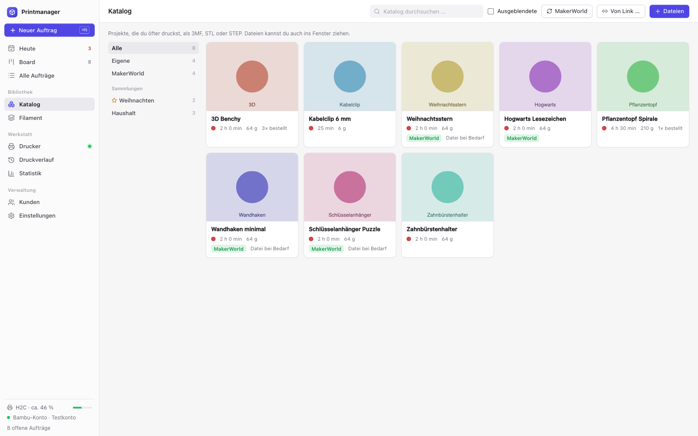

<div align="center">

# Printmanager

### Die Werkstatt-Zentrale für deinen Bambu-Lab-Drucker

Printmanager begleitet einen Druckwunsch vom ersten Auftrag bis zur Übergabe. Gedruckt wird mit Bambu Studio, Filament und Kosten hast du dabei im Blick.

[**Download für macOS & Windows**](https://github.com/aidun/printmanager/releases/latest) · [Benutzerhandbuch](docs/BENUTZERHANDBUCH.md) · [Neuigkeiten](CHANGELOG.md) · [Für Entwickler](#für-entwickler)


</div>

---

## Warum Printmanager?

Wer für Familie, Freunde oder einen kleinen Kundenkreis druckt, hat schnell viel zu verwalten: Nachrichten, Dateien, Farbwünsche, Spulen und die Frage, was ein Druck eigentlich kostet. Printmanager bündelt das alles. Die App arbeitet dafür mit **Bambu Studio** und deinem **Bambu-Lab-Konto** zusammen.

| | |
|---|---|
| 🗂 **Jeder Auftrag an einem Ort** | Kunde, Teile, Farbwünsche, Dateien, Bilder, Links und Notizen stehen in einem Auftrag. Er durchläuft feste Schritte von „Eingang“ bis „Übergeben“. |
| 🖨 **Direkt zu Bambu Studio und zurück** | Ein Klick öffnet die Datei in Bambu Studio. Speicherst du sie dort gesliced, übernimmt die App Druckzeit und Gramm von selbst. |
| 📡 **Live vom Drucker** | Du siehst Fortschritt und Restzeit laufender Drucke. Fertige Drucke landen mit ihrer echten Dauer im richtigen Auftrag. |
| 🧵 **Filament immer aktuell** | Die Spulen kommen aus deinem Bambu-Konto, mit dem AMS-Slot, in dem sie stecken. Beim Abziehen des Verbrauchs schlägt die App die passende Spule vor. |
| 💶 **Kosten und Preis auf einen Blick** | Beim Anlegen siehst du geschätzte Kosten, nach dem Druck die tatsächlichen. Filamentpreis, Strompreis und Aufschlag stellst du selbst ein. |
| 📈 **Ehrliche Statistik** | Verbrauch, Druckzeit und Fehldrucke über alle Drucke. Bei abgebrochenen Drucken zählt der geschätzt tatsächliche Verbrauch statt des vollen geplanten Werts. |

---

## So arbeitest du damit

### 1 · Auftrag anlegen in vier Schritten
Du suchst den Kunden oder legst ihn direkt neu an. Dann wählst du ein Projekt aus dem Katalog, fügst einen Link von MakerWorld oder Printables ein oder ziehst eigene Dateien hinein. Schon hier zeigt die App geschätzte Kosten und einen Preisvorschlag.


### 2 · Den Überblick behalten
Das Board zeigt jeden Auftrag in seinem Arbeitsschritt. Zum Weiterschalten ziehst du die Karte in die nächste Spalte. Auf der Seite **Heute** stehen Fälliges, laufende Drucke und Drucke, die noch ausgewertet werden müssen.


### 3 · Drucken, erfassen, abrechnen
Im Auftrag öffnest du die Druckdatei in Bambu Studio. Nach dem Druck meldet der Drucker Dauer und Verbrauch. Du ziehst das Filament von der richtigen Spule ab, und die Kalkulation zeigt statt der Schätzung jetzt die **tatsächlichen Kosten**.


---

## Alles, was drin ist

### Druckverlauf
Hier stehen alle Drucke aus deinem Bambu-Konto, mit Vorschaubild, echter Dauer und Filament.
- Filtern kannst du nach Zeitraum, Material, Drucker und Ergebnis.
- Über eine Suche ordnest du einen Druck nachträglich einem Auftrag zu.
- Bei Abbrüchen zeigt die App den geschätzt tatsächlich verbrauchten Anteil, etwa „≈ 15 g von 84 g“.


### Statistik
Filament, Druckzeit, Fehldrucke und Übergaben, aufgeteilt nach Monat, Kunde und Material.
- Ausgewertet werden wahlweise **alle Drucke im Konto** oder **nur Aufträge**.
- Gefiltert wird nach fertigen, erfolgreichen, abgebrochenen oder geplanten Drucken.



### Katalog und MakerWorld
Deine bewährten Projekte stehen hier mit Vorschau, Druckzeit und Filamenten. Deine **MakerWorld-Sammlungen** erscheinen von selbst. Die 3MF-Datei lädt die App erst, wenn du sie brauchst.



### Filament
Alle Spulen mit Restmenge, nach Material gruppiert. Knappe Spulen sind markiert, und jede Spule zeigt den Slot, in dem sie gerade steckt. Auf Wunsch schreibt die App den neuen Rest ins Bambu-Konto zurück, und mit − und + änderst du dort den Vorrat gleicher Spulen.


### Drucker und Kunden
Die Drucker-Seite zeigt Status, Fortschritt und den zugehörigen Auftrag. In der Kundenverwaltung hat jeder Kunde eine Kundennummer, eine Adresse, optional eine abweichende Rechnungsadresse und eine Liste seiner Aufträge.

| Drucker | Kunden |
|---|---|
|  |  |

---

## Sicher und privat

- **Deine Daten bleiben bei dir.** Alles liegt in einer Datenbank auf deinem Rechner. Zum Sichern kopierst du den Datenordner.
- **Die App liest, solange du nichts anderes willst.** Printmanager steuert keinen Drucker. Ab Werk ändert die App nichts an deinem Bambu-Konto. Auf Wunsch schreibt sie den Rest deiner Spulen und den Spulenvorrat zurück, jedes Mal erst nach deiner Bestätigung. Drucke startest du wie gewohnt in Bambu Studio oder Bambu Handy.
- **Dein Passwort sieht die App nicht.** Die Anmeldung läuft im Fenster von Bambu Lab, das Anmelde-Token liegt im Schlüsselbund deines Systems.
- **Hell und dunkel**, passend zu deinem System.

> Hinweis: Die Anbindung an das Bambu-Konto nutzt Schnittstellen, die Bambu nicht offiziell dokumentiert. Ändert Bambu sie, arbeitet die App mit den zuletzt bekannten Daten weiter.

---

## Installation

1. Lade die neueste Version unter [**Releases**](https://github.com/aidun/printmanager/releases/latest):
   - **macOS** (Apple Silicon und Intel): `Printmanager_…_universal.dmg`
   - **Windows**: `Printmanager_…_x64-setup.exe`
2. Installiere und starte die App. Die Builds sind noch nicht signiert:
   - macOS: Beim ersten Start Rechtsklick → **Öffnen**.
   - Windows: Bei SmartScreen **Weitere Informationen → Trotzdem ausführen**.
3. Optional: Unter **Einstellungen → Anbindungen → Bambu-Konto → Anmelden** verbindest du dein Konto. Dann kommen Filament, Drucker, Druckverlauf und MakerWorld dazu.

**Voraussetzungen:** macOS 11 oder neuer bzw. Windows 10 oder 11, dazu Bambu Studio zum Slicen. Ein Bambu-Lab-Konto ist optional.

---

## Häufige Fragen

**Brauche ich ein Bambu-Konto?** Nein. Aufträge, Katalog, Kalkulation und der Weg zu Bambu Studio funktionieren auch ohne. Mit Konto kommen Filament, Druckerstatus, Druckverlauf und MakerWorld dazu.

**Wie genau ist der Verbrauch?** Der Drucker misst den Verbrauch nicht. Die Gramm stammen aus dem Slicer. Bei abgebrochenen Drucken schätzt die App den tatsächlichen Anteil aus dem Fortschritt oder der Laufzeit.

**Wie entsteht der Preisvorschlag?** Die App rechnet (Material + Strom + Maschine) × (1 + Puffer für Fehldrucke) × Preisfaktor + Pauschale und rundet auf. Alle Werte stellst du unter **Einstellungen → Kalkulation** ein.

**Ändert die App mein Bambu-Konto?** Ab Werk nicht. Schaltest du unter **Einstellungen → Anbindungen** das Schreiben ein, kann sie den Rest deiner Spulen zurückschreiben und Spulen anlegen oder löschen, jedes Mal erst nach deiner Bestätigung. Drucker steuert sie nie.

**Funktioniert es mit mehreren Druckern?** Ja. Alle Drucker deines Bambu-Kontos erscheinen auf der Drucker-Seite.

Mehr steht im [Benutzerhandbuch](docs/BENUTZERHANDBUCH.md).

---

## Für Entwickler

Tauri 2 (Rust) mit React/TypeScript, dazu SQLite (optional PostgreSQL).

```bash
npm install
```

```bash
npm run tauri dev
```

```bash
npm run dev
```

`npm run dev` startet nur die Oberfläche unter http://localhost:1420, mit Beispieldaten aus `src/devmock.ts`. Einzelne Ansichten öffnest du über die Adresse, z.B. `#board&order=o8` oder `#today&neu`. So entstehen auch die Produktbilder in `docs/images/`.

```bash
cd src-tauri && cargo test
```

- Regeln, Befehle und Konventionen: [AGENTS.md](AGENTS.md)
- Aufbau, Datenmodell und Schnittstellen: [docs/ARCHITEKTUR.md](docs/ARCHITEKTUR.md)
- CI läuft bei jedem Push. Release-Builds für macOS und Windows entstehen über Tags `vX.Y.Z` (`.github/workflows/`).
- Entscheidungen und frühere Pläne: [docs/history/](docs/history/)

**Daten:** `~/Library/Application Support/de.printmanager.app` (Windows: `%APPDATA%\de.printmanager.app`) mit `printmanager.db`, `orders/<Nr>/`, `catalog/<id>/` und `trash/`.
